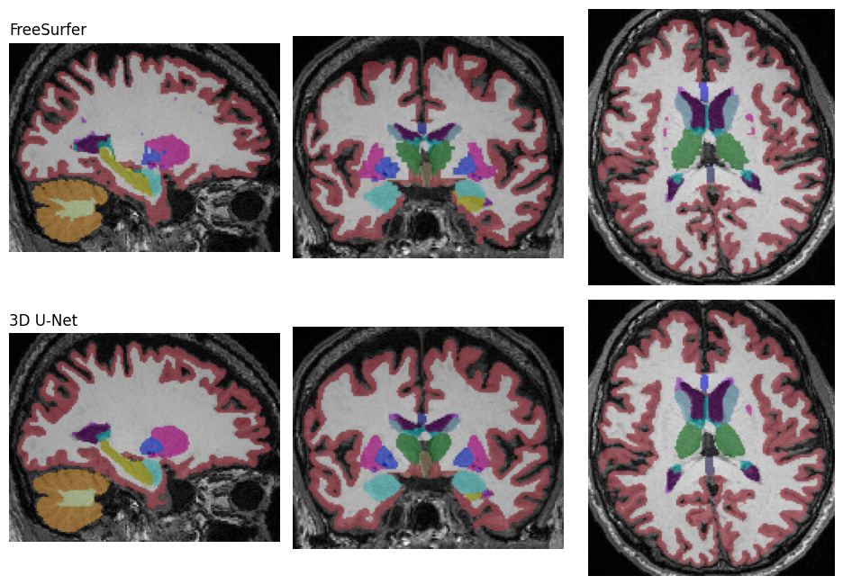
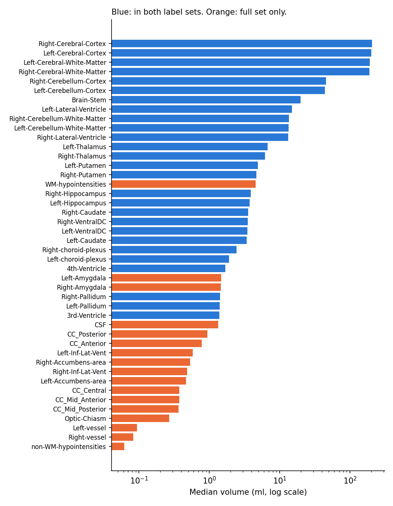
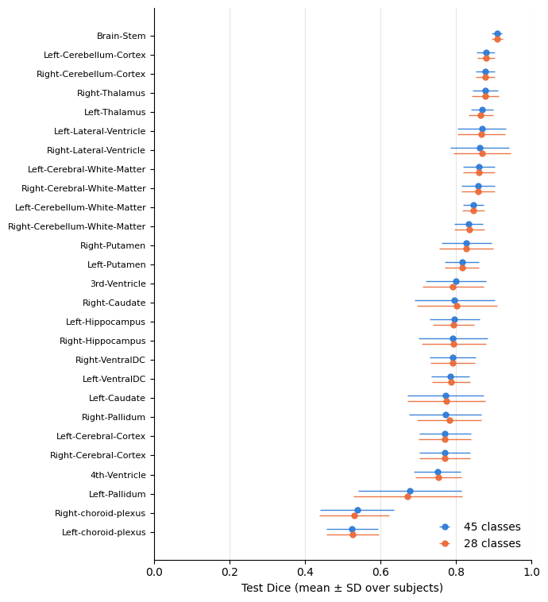
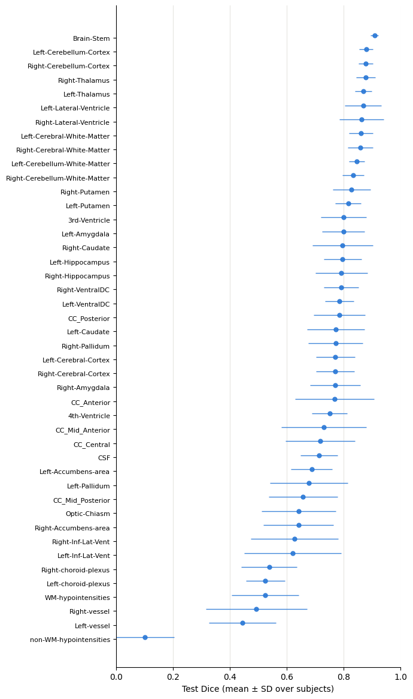
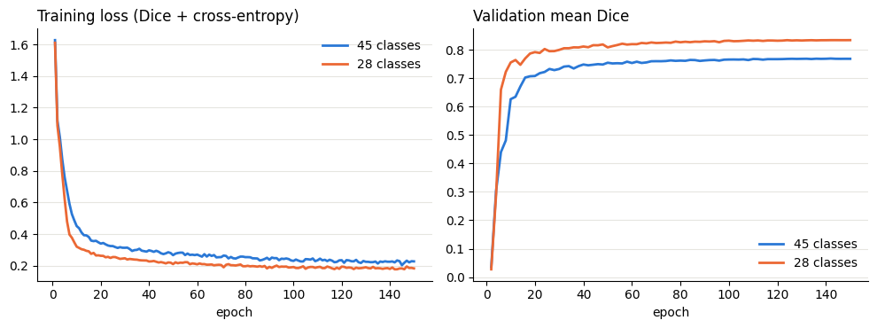
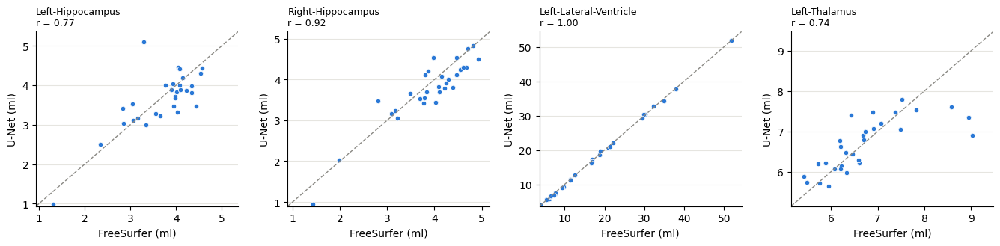

# Whole-brain segmentation of T1 MRI into 44 FreeSurfer structures

[](https://github.com/anupbagale/Whole-Brain-Segmentation/actions/workflows/tests.yml)
[](https://colab.research.google.com/github/anupbagale/Whole-Brain-Segmentation/blob/main/notebooks/02_train_and_evaluate.ipynb)
[](LICENSE)

FreeSurfer takes hours to segment one brain scan. A 3D U-Net can do it in seconds once it is trained. In this project I train a U-Net on 148 OASIS-3 T1 scans to reproduce the full FreeSurfer `aseg` segmentation, all 44 structures at once, from the cerebral white matter down to the optic chiasm and the five parts of the corpus callosum.



## Questions

1. **How well does one network segment all 44 structures?** The structures differ a lot in size, so the small ones are hard to learn next to the big ones.
2. **Does it help to leave some structures out?** I trained a second network on a reduced set of 27 structures, leaving out the smallest ones and those without a clear boundary, and compared both on the structures they have in common.
3. **Are the volumes right?** Segmentations are often used to measure structure volumes, so I compared the U-Net volumes with the FreeSurfer volumes.

## Results

### The data

All 44 structures appear in every one of the 148 scans, but their sizes are very different. The right cerebral cortex has a median volume of 207 ml and the non-WM hypointensities 0.06 ml, about 3,400 times smaller. Thirteen structures are under 1 ml. All of them are in the group left out of the reduced set, and together the 17 left-out structures make up only about 1.4% of the labelled volume.



### Segmentation accuracy

Both models were trained on 100 scans, with 18 for validation and 30 held out for testing. Each test scan was segmented, scaled back to the original 1 mm grid and compared with the FreeSurfer labels. The table shows the mean Dice per subject, as mean ± SD over the 30 test subjects.

| Model | Mean Dice, all its structures | Mean Dice, 27 shared structures |
|---|---|---|
| 45 classes (44 structures) | 0.733 ± 0.057 | 0.797 ± 0.047 |
| 28 classes (27 structures) | 0.798 ± 0.047 | 0.798 ± 0.047 |

**Adding the 17 extra structures did not cost anything.** On the 27 structures both models share, they score the same (paired difference -0.0003, Wilcoxon signed-rank p = 0.33). So the 45-class model gives the amygdala, accumbens, corpus callosum and the other extra structures without losing accuracy on the rest. Its lower overall mean comes from the extra structures being harder, not from doing worse on the shared ones.



The best structures were the brain stem (0.91), the cerebellar cortex (0.88) and the thalamus (0.87 to 0.88). The worst were the ones that are tiny or have no clear shape: non-WM hypointensities (0.10), the vessels (0.44 to 0.49), WM hypointensities (0.52) and the choroid plexus (0.53 to 0.54). The cerebral cortex reached only about 0.77 even though it is the largest structure, because it is thin and the 128³ input (about 2 mm voxels) blurs it.



Both training runs levelled off long before the last epoch, so longer training would not change much.



### Volumes

Volumes from the 45-class model compared with FreeSurfer on the 30 test subjects (full table in [`results/volume_agreement.csv`](results/volume_agreement.csv)):

- **Lateral ventricles:** almost identical to FreeSurfer (r = 1.00, within 2 to 4%). Ventricle size is a common marker of atrophy, so this is a useful result.
- **Hippocampus:** r = 0.92 on the right and 0.77 on the left, where one subject is off by 1.8 ml. On average the difference is under 0.1 ml, but for a single person it can be up to about ±1 ml.
- **Dice and volume are not the same thing.** WM hypointensities have a low Dice (0.52), but their volume follows FreeSurfer closely (r = 0.98). The model finds about the right amount of this tissue, just not always in the same voxels.
- **Systematic biases:** the cortex comes out about 7% too large and the cerebral white matter about 3% too small, so the boundary between them is shifted. Small structures are underestimated, for example the vessels by 13 to 18% and the non-WM hypointensities by 70%.



## How it works

- **Data.** T1-weighted scans from OASIS-3 with their FreeSurfer `aseg` label maps (256 × 256 × 256, 1 mm). Subjects are split at random into training, validation and test sets, and all scans of one person stay in the same set.
- **Labels.** FreeSurfer label values (2, 3, 4, ... 255) are mapped to class indices 0 to 44 for training and mapped back when predictions are saved. The reduced set keeps 27 structures and sets the rest to background. Both lists are in [`wbseg/labels.py`](wbseg/labels.py).
- **Preprocessing.** The whole head is resized to 128³ and intensities are scaled to 0 to 1 using the 0.5th and 99.5th percentiles. Training uses small random rotations and scaling, intensity scaling and noise. There are no left-right flips, because a flip would turn left structures into right ones.
- **Model.** MONAI 3D U-Net with residual units, 5 levels (16 to 256 channels), batch norm. Loss: Dice + cross-entropy. Adam, learning rate 1e-3 with cosine decay, mixed precision, 150 epochs, keeping the epoch with the best validation Dice. One epoch took about 30 seconds on a Colab T4 GPU.
- **Evaluation.** The network's class scores are resized back to 256³ before the argmax, so Dice and volumes are measured on the original grid against the original label maps. Predictions are saved as NIfTI files with FreeSurfer label values and the original image header, so they open directly in FreeView or ITK-SNAP.

## Notebooks

| Notebook | What it does | |
|---|---|---|
| [01_data_and_labels](notebooks/01_data_and_labels.ipynb) | Checks the data, compares the two label sets, plots how big each structure is | [](https://colab.research.google.com/github/anupbagale/Whole-Brain-Segmentation/blob/main/notebooks/01_data_and_labels.ipynb) |
| [02_train_and_evaluate](notebooks/02_train_and_evaluate.ipynb) | Trains both U-Nets on a GPU, tests them, writes `results/summary.md` | [](https://colab.research.google.com/github/anupbagale/Whole-Brain-Segmentation/blob/main/notebooks/02_train_and_evaluate.ipynb) |
| [03_structure_volumes](notebooks/03_structure_volumes.ipynb) | Compares U-Net and FreeSurfer volumes, exports a volume table | [](https://colab.research.google.com/github/anupbagale/Whole-Brain-Segmentation/blob/main/notebooks/03_structure_volumes.ipynb) |

Run them in order: notebook 3 uses the test results from notebook 2. Training saves a checkpoint to Google Drive after every epoch, so if Colab disconnects you can run all cells again and it continues where it stopped.

## Running it

1. Get access to OASIS-3 (see below) and put the T1 images and the `aseg` label maps in two folders on your Google Drive.
2. Copy the `wbseg` folder from this repository into **My Drive** (or upload it as `wbseg.zip`, which the notebooks unpack themselves).
3. Optionally add `FreeSurferColorLUT.txt` from a FreeSurfer installation to My Drive to get the standard FreeSurfer colours in the figures.
4. Open a notebook in Colab, set the two data folders in the second code cell, and run all cells. Results and figures are saved to `My Drive/wbseg_outputs`.

To run the tests locally:

```bash
pip install -r requirements.txt
python -m pytest tests     # uses small synthetic volumes, no data needed
```

## Code

```
wbseg/
  labels.py     the 45- and 28-class label sets, structure names, label mapping, colours
  data.py       matching images to label maps, subject-level split, MONAI transforms
  train.py      U-Net and training loop with checkpoints and early stopping
  evaluate.py   prediction at the original resolution, Dice per structure
  volumes.py    structure volumes from any label map, agreement with FreeSurfer
  plots.py      figures
notebooks/      the three notebooks above
results/        test summary, structure sizes and volume agreement (no per-subject data)
figures/        all figures in this README
tests/          tests on synthetic brains, run by GitHub Actions on every push
```

## Limitations

- FreeSurfer's output is used as the ground truth, so the network learns FreeSurfer's mistakes too. Dice here measures agreement with FreeSurfer, not with manual tracing.
- Resizing the head to 128³ halves the resolution. This hurts thin and small structures most, which shows up in the cortex Dice and in the underestimated volumes of small structures.
- The results come from one random split with 30 test subjects. Cross-validation would give a better idea of how much they vary.
- Two test scans (OAS30108 and OAS30158) score much lower than the rest in both models: mean Dice 0.53 with the 45-class model, where the other 28 subjects are between 0.72 and 0.78. I have not looked into why yet. They are included in all results above.
- All scans come from one dataset, so this does not show how the model would do on scans from other scanners or protocols.

## Data

No OASIS-3 images, labels or per-subject results are included here. The data is available after accepting the OASIS data use agreement at [oasis-brains.org](https://www.oasis-brains.org).

Data were provided by OASIS-3: Longitudinal Multimodal Neuroimaging: Principal Investigators: T. Benzinger, D. Marcus, J. Morris; NIH P30 AG066444, P50 AG00561, P30 NS09857781, P01 AG026276, P01 AG003991, R01 AG043434, UL1 TR000448, R01 EB009352, AW00006993.

## License

MIT for the code. The OASIS-3 data has its own terms.
